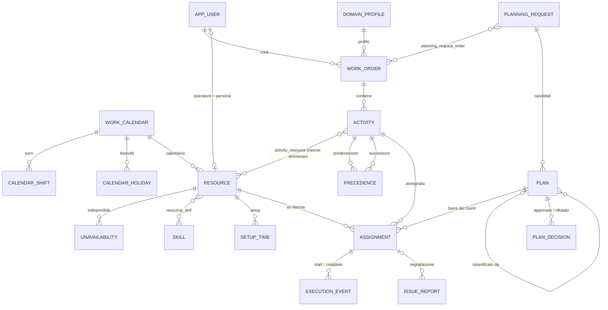

# FlowSync – Database

Schema MySQL 8 del backend Spring Boot, versionato con Flyway. 23 tabelle e 1 vista, divise per modulo del monolite modulare.

## Diagramma ER (parte principale)



## Tabelle per modulo

| Modulo | Tabelle | A cosa servono |
|---|---|---|
| Security | `app_user` | Utenti con ruolo ADMIN, PLANNER, OPERATOR; l'operatore è collegato alla sua risorsa "persona" |
| Configuration | `domain_profile`, `work_calendar`, `calendar_shift`, `calendar_holiday`, `skill`, `resource`, `resource_skill`, `unavailability` | Profili di dominio con pesi predefiniti, turni, festività, risorse, competenze, manutenzioni e ferie |
| Orders | `work_order`, `activity`, `activity_resource`, `precedence`, `setup_time` | Commesse, attività (nodi), risorse ammesse, precedenze (archi), matrice dei setup |
| Planning | `planning_request`, `planning_request_order`, `plan`, `assignment` | Richiesta all'AI con snapshot della ProblemSpec, piani candidati con KPI, barre del Gantt con la stima di M1 |
| Decisions | `plan_decision` | Approvazioni e rifiuti con motivazione |
| Execution | `execution_event`, `issue_report`, vista `v_activity_actuals` | Inizio e fine registrati dall'operatore, guasti; la vista dà le durate reali per addestrare M1 |
| Audit | `audit_log` | Chi ha fatto cosa, con prima/dopo in JSON |
| Models | `model_version` | Versioni pubblicate dalla pipeline di training (contratto C); al massimo una ACTIVE per modello |

## Scelte di progetto

- **Flyway crea lo schema, Hibernate lo controlla** (`ddl-auto: validate`). Una migrazione già applicata non si modifica mai: per cambiare qualcosa si aggiunge `V7__...sql`.
- **Gli "enum" sono `VARCHAR` + `CHECK`**, non `ENUM` di MySQL. Aggiungere un valore costa una migrazione di una riga, e su Java `@Enumerated(STRING)` resta leggibile.
- **Date e ore in `DATETIME(6)`, sempre in UTC.** In Java si usa `Instant`; il fuso (Europe/Rome) lo applica il frontend. Fanno eccezione i turni (`TIME`), che sono orari locali del calendario.
- **JSON dove la struttura varia**: ProblemSpec, pesi degli obiettivi, dettagli dei KPI, payload dell'audit. I KPI che servono per ordinare e filtrare (makespan, ritardo, straordinari, utilizzo) sono invece colonne normali.
- **`planning_request.problem_spec` è uno snapshot.** Il piano resta riproducibile anche se commesse o risorse cambiano dopo, e ogni richiesta reale diventa un esempio in più per il training.
- **I cicli nel grafo li controlla il servizio**, non il DB. MySQL non permette un `CHECK predecessor_id <> successor_id` sulle colonne con `ON DELETE CASCADE`.
- **Lock ottimistico (`@Version`)** su `work_order` e `plan`: due pianificatori che modificano lo stesso piano non si sovrascrivono a vicenda.
- **`execution_event` è append-only.** Non si corregge un evento, se ne aggiunge un altro. La vista `v_activity_actuals` confronta durata reale e stima di M1: è il dataset di M1 in produzione.

## Migrazioni

| File | Contenuto |
|---|---|
| `V1__security.sql` | `app_user` |
| `V2__configuration.sql` | Profili, calendari, risorse, competenze, indisponibilità; collegamento utente → risorsa |
| `V3__orders.sql` | Commesse, attività, risorse ammesse, precedenze, setup |
| `V4__planning.sql` | Richieste, piani, assegnazioni |
| `V5__decisions_execution.sql` | Decisioni, eventi di esecuzione, segnalazioni, vista per M1 |
| `V6__audit_models.sql` | Audit e versioni dei modelli |
| `db/seed/V100__demo_data.sql` | Solo profilo `dev`: l'officina dei mockup (utenti demo, 9 risorse, C-101…C-104, manutenzione CNC 2) |

Gli utenti demo (`admin`, `gneri`, `mrossi`) hanno password `flowsync-dev`, da usare solo in sviluppo.

## Entità JPA incluse

Package `it.unicam.flowsync.<modulo>.domain`: `AppUser`, `Resource`, `WorkCalendar` (con `Shift`), `Unavailability`, `WorkOrder`, `Activity`, `Precedence`, `PlanningRequest`, `Plan`, `Assignment`, `ExecutionEvent`, `AuditLog`.
Le tabelle restanti (`skill`, `domain_profile`, `setup_time`, `plan_decision`, `issue_report`, `model_version`, …) seguono lo stesso schema.

Dipendenze: `spring-boot-starter-data-jpa`, `flyway-core` + `flyway-mysql`, `mysql-connector-j`, `lombok`.

## Da verificare al primo avvio

Il codice Java non è stato compilato: in questo ambiente Maven Central non è raggiungibile. Il primo test è avviare il backend con `ddl-auto: validate` su un MySQL 8 vuoto. Due punti da controllare:

- **Booleani:** sono mappati con `columnDefinition = "TINYINT(1)"`, perché su MySQL `BOOLEAN` diventa `TINYINT(1)` e Hibernate 6 altrimenti si aspetta `BIT`.
- **Enum:** sono mappati con `@JdbcTypeCode(SqlTypes.VARCHAR)`, perché da Hibernate 6.2 su MySQL l'enum diventerebbe un `ENUM` nativo.

Se la validazione segnala una colonna, quasi sempre si tratta di una differenza di tipo come queste.

---

# Backend REST

Primo blocco implementato: fondamenta (errori, sicurezza), login JWT e modulo Configuration (risorse, competenze, calendari in sola lettura). Il resto del contratto A (`CONTRATTI_API.md`) segue modulo per modulo.

## Avvio in locale

```bash
docker compose up -d                                   # MySQL 8.4 su localhost:3306 (utente flowsync / flowsync)
SPRING_PROFILES_ACTIVE=dev mvn spring-boot:run         # migrazioni Flyway + dati demo
```

Con il profilo `dev` si ha un segreto JWT di comodo e la password del DB `flowsync`; fuori da `dev` servono le variabili `DB_PASSWORD` e `JWT_SECRET` (almeno 32 caratteri). Utenti demo: `admin` (ADMIN), `gneri` (PLANNER), `mrossi` (OPERATOR), tutti con password `flowsync-dev`.

- Swagger UI: <http://localhost:8080/swagger-ui.html> (bottone *Authorize*: incollare l'`accessToken` del login)
- Salute: <http://localhost:8080/actuator/health>

```bash
curl -s localhost:8080/api/v1/auth/login -H 'Content-Type: application/json' \
     -d '{"username":"admin","password":"flowsync-dev"}'
curl -s localhost:8080/api/v1/resources -H "Authorization: Bearer <accessToken>"
```

Con il frontend: in `src/frontend/.env.development` mettere `VITE_USE_MOCKS=false` e fare il proxy di `/api` verso `localhost:8080` nella configurazione di Vite. Il frontend non manda ancora l'header `Authorization` (c'è un commento in `api/client.ts`): finché non c'è la pagina di login, le chiamate dal browser avranno 401.

## Test

```bash
mvn test        # richiede Docker acceso: Testcontainers avvia un MySQL 8.4 vero, unico per tutta la suite
```

| Classe | Cosa verifica |
|---|---|
| `SchemaAndMigrationsTest` | Il contesto parte: Flyway applica V1–V6 + seed e Hibernate (`ddl-auto: validate`) trova le entità coerenti con lo schema. **È il primo test da guardare.** |
| `AuthApiTest` | Login, refresh, `/auth/me`, token manomesso o del tipo sbagliato, formato problem+json |
| `ResourceApiTest` | Permessi per ruolo, CRUD, disattivazione, 404/409/422, competenze, riepilogo dei turni |
| `ShiftSummarizerTest` | Logica pura del riepilogo turni (senza Docker) |

## Endpoint implementati

| Metodo | Path | Ruoli | Note |
|---|---|---|---|
| POST | `/api/v1/auth/login` | pubblico | access (15 min) + refresh (7 giorni) |
| POST | `/api/v1/auth/refresh` | pubblico | accetta solo refresh token |
| GET | `/api/v1/auth/me` | tutti | |
| GET | `/api/v1/resources[?active=]` | tutti | |
| GET | `/api/v1/resources/{id}` | tutti | `id` = codice (es. `LASER`) |
| POST / PUT | `/api/v1/resources[/{id}]` | ADMIN | 409 codice doppio, 422 competenza o calendario inesistenti |
| DELETE | `/api/v1/resources/{id}` | ADMIN | disattiva (204), idempotente |
| GET | `/api/v1/skills`, `/api/v1/calendars` | tutti | alimentano le tendine del frontend |

## Scelte

- **L'`id` pubblico è il codice**, non la chiave BIGINT: `LASER`, `ORD-0012`. Il frontend non vede mai gli id numerici. Per i calendari, che non hanno un codice nello schema, l'`id` è la chiave numerica come stringa opaca (`"1"`).
- **Errori sempre `application/problem+json`**, anche quelli dei filtri di sicurezza (401/403), con `traceId` (uguale all'header `X-Request-Id`, lo si ritrova nei log). Un input sintatticamente valido ma inconsistente è 422 con l'elenco `errors[{code, path, message}]`; il JSON malformato è 400.
- **JWT HS256 con il resource server di Spring Security**, nessuna libreria in più. Access e refresh hanno un claim `token_use`: un refresh token non apre le API e un access token non rinnova. Il refresh rilegge l'utente dal DB, quindi un account disattivato o un ruolo cambiato valgono subito al rinnovo.
- **Limite noto:** i refresh token non si possono revocare prima della scadenza (niente tabella dei token). Per un prototipo è accettabile; se serve il logout "vero" si aggiunge una tabella con i `jti` revocati.
- **Nessun limite ai tentativi di login** per ora (da aggiungere prima di un uso reale).
- **Le competenze di una risorsa** si inviano come elenco di codici; le nuove partono dal livello 1, quelle già presenti conservano il loro livello.

## Difformità da chiarire con il frontend

- `ResourceType` nel frontend è `MACHINE | PERSON | ROOM`, ma lo schema ammette anche `TEAM` e il backend lo restituisce.
- Il frontend si aspetta `costPerHour` e `unavailability` nella risorsa (PROPOSTA §8 di `FRONTEND_STRUTTURA.md`): il backend per ora li ignora in scrittura e non li restituisce. Servono una colonna in più (migrazione V7) e una decisione sul contratto.
- `CONTRATTI_API.md` e `Spiegazione_architettura_VPP.txt` nominano ancora Angular.
