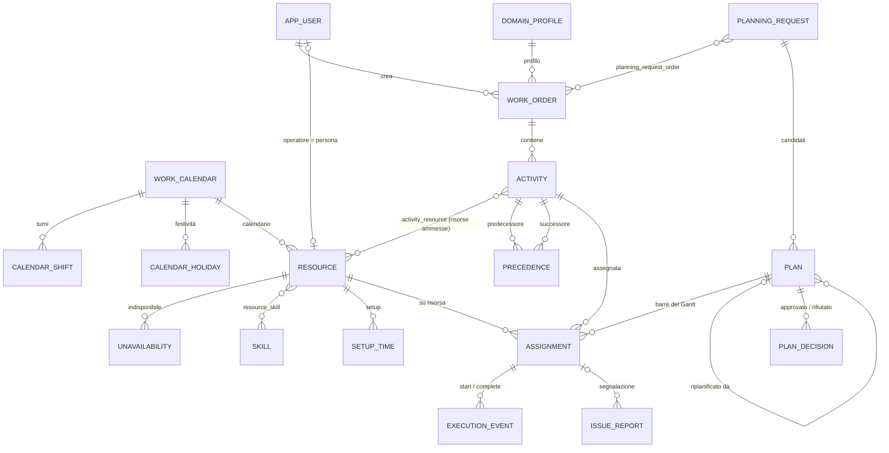

# FlowSync – Database

Schema MySQL 8 del backend Spring Boot, versionato con Flyway. 23 tabelle e 1 vista, divise per modulo del monolite modulare.

## Diagramma ER (parte principale)



## Tabelle per modulo

| Modulo | Tabelle | A cosa servono |
|---|---|---|
| Security | `app_user` | Utenti con ruolo ADMIN, PLANNER, OPERATOR; l'operatore è collegato alla sua risorsa "persona" |
| Configuration | `domain_profile`, `work_calendar`, `calendar_shift`, `calendar_holiday`, `skill`, `resource`, `resource_skill`, `unavailability` | Profili di dominio con pesi predefiniti, turni, festività, risorse, competenze, manutenzioni e ferie |
| Orders | `work_order`, `activity`, `activity_resource`, `precedence`, `setup_time` | Commesse, attività (nodi), risorse ammesse, precedenze (archi), matrice dei setup |
| Planning | `planning_request`, `planning_request_order`, `plan`, `assignment` | Richiesta all'AI con snapshot della ProblemSpec, piani candidati con KPI, barre del Gantt con la stima di M1 |
| Decisions | `plan_decision` | Approvazioni e rifiuti con motivazione |
| Execution | `execution_event`, `issue_report`, vista `v_activity_actuals` | Inizio e fine registrati dall'operatore, guasti; la vista dà le durate reali per addestrare M1 |
| Audit | `audit_log` | Chi ha fatto cosa, con prima/dopo in JSON |
| Models | `model_version` | Versioni pubblicate dalla pipeline di training (contratto C); al massimo una ACTIVE per modello |

## Scelte di progetto

- **Flyway crea lo schema, Hibernate lo controlla** (`ddl-auto: validate`). Una migrazione già applicata non si modifica mai: per cambiare qualcosa si aggiunge `V7__...sql`.
- **Gli "enum" sono `VARCHAR` + `CHECK`**, non `ENUM` di MySQL. Aggiungere un valore costa una migrazione di una riga, e su Java `@Enumerated(STRING)` resta leggibile.
- **Date e ore in `DATETIME(6)`, sempre in UTC.** In Java si usa `Instant`; il fuso (Europe/Rome) lo applica il frontend. Fanno eccezione i turni (`TIME`), che sono orari locali del calendario.
- **JSON dove la struttura varia**: ProblemSpec, pesi degli obiettivi, dettagli dei KPI, payload dell'audit. I KPI che servono per ordinare e filtrare (makespan, ritardo, straordinari, utilizzo) sono invece colonne normali.
- **`planning_request.problem_spec` è uno snapshot.** Il piano resta riproducibile anche se commesse o risorse cambiano dopo, e ogni richiesta reale diventa un esempio in più per il training.
- **I cicli nel grafo li controlla il servizio**, non il DB. MySQL non permette un `CHECK predecessor_id <> successor_id` sulle colonne con `ON DELETE CASCADE`.
- **Lock ottimistico (`@Version`)** su `work_order` e `plan`: due pianificatori che modificano lo stesso piano non si sovrascrivono a vicenda.
- **`execution_event` è append-only.** Non si corregge un evento, se ne aggiunge un altro. La vista `v_activity_actuals` confronta durata reale e stima di M1: è il dataset di M1 in produzione.

## Migrazioni

| File | Contenuto |
|---|---|
| `V1__security.sql` | `app_user` |
| `V2__configuration.sql` | Profili, calendari, risorse, competenze, indisponibilità; collegamento utente → risorsa |
| `V3__orders.sql` | Commesse, attività, risorse ammesse, precedenze, setup |
| `V4__planning.sql` | Richieste, piani, assegnazioni |
| `V5__decisions_execution.sql` | Decisioni, eventi di esecuzione, segnalazioni, vista per M1 |
| `V6__audit_models.sql` | Audit e versioni dei modelli |
| `V7__user_registration.sql` | Approvazione delle registrazioni (`approved_at`, `approved_by`) |
| `V8__orders_api.sql` | Commesse nel formato del contratto: rilascio, competenze richieste come lista, `max_lag_min`, descrizione e vincoli dei profili |
| `V10__execution_reschedule.sql` | Ripianificazione (`reschedule_of`, `trigger_event`, `freeze_before`), profilo in uso, nota delle esecuzioni, piano delle segnalazioni, dataset e spec dei modelli |
| `V9__planning_api.sql` | Pianificazione v1.1: etichetta, fase, baseline e calendario della richiesta; variante, confidenza e riepilogo del piano; `start_min`/`end_min` delle assegnazioni; decisione `MODIFIED`; `resource.cost_per_hour` |
| `db/seed/V100__demo_data.sql` | Solo profilo `dev`: l'officina dei mockup (utenti demo, 9 risorse, C-101…C-104, manutenzione CNC 2) |
| `db/seed/V101__profiles_contract_shape.sql` | Solo `dev`: profili FACTORY, PA, PROJECT nel formato del contratto |
| `db/seed/V102__frontend_demo_users.sql` | Solo profilo `dev`: utenti demo rinominati come nel frontend, password `demo` |
| `db/seed/V103__resource_costs.sql` | Solo `dev`: costo orario delle risorse dell'officina |
| `db/seed/V104__planning_demo.sql` | Solo `dev`: grafi di C-102…C-104, scadenze spostate a partire dal giorno in cui si applica, fermo della CNC 2 il martedì della settimana dopo, setup acciaio/inox |

Gli utenti demo (`amministratore`, `pianificatore`, `operatore`, allineati al frontend) hanno password `demo`, da usare solo in sviluppo. I nomi e la password sono impostati da `db/seed/V102__frontend_demo_users.sql`.

## Entità JPA incluse

Package `it.unicam.flowsync.<modulo>.domain`: `AppUser`, `Resource`, `WorkCalendar` (con `Shift`), `Unavailability`, `WorkOrder`, `Activity`, `Precedence`, `PlanningRequest`, `Plan`, `Assignment`, `ExecutionEvent`, `AuditLog`.
Le tabelle restanti (`skill`, `domain_profile`, `setup_time`, `plan_decision`, `issue_report`, `model_version`, …) seguono lo stesso schema.

Dipendenze: `spring-boot-starter-data-jpa`, `flyway-core` + `flyway-mysql`, `mysql-connector-j`, `lombok`.

## Da verificare al primo avvio

Stato al 26/11/2026: `mvn test` passa (87 test, Testcontainers con MySQL 8.4), compresi i test di integrazione di pianificazione, esecuzione, ripianificazione e audit con un servizio AI finto. Tre scelte di mappatura che la validazione dello schema richiede:

- **Booleani:** sono mappati con `columnDefinition = "TINYINT(1)"`, perché su MySQL `BOOLEAN` diventa `TINYINT(1)` e Hibernate 6 altrimenti si aspetta `BIT`.
- **Enum:** sono mappati con `@JdbcTypeCode(SqlTypes.VARCHAR)`, perché da Hibernate 6.2 su MySQL l'enum diventerebbe un `ENUM` nativo.
- **Orari dei turni:** si leggono e scrivono come testo (`LocalTimeAsTextConverter`, colonna `TIME`). Con `hibernate.jdbc.time_zone: UTC` Hibernate convertirebbe un `TIME` nel fuso della JVM: a Roma le 08:00 diventavano 09:00.

Se la validazione segnala una colonna, quasi sempre si tratta di una differenza di tipo come queste.

---

# Backend REST

Implementato: fondamenta (errori, sicurezza), login JWT, registrazione con approvazione, modulo Configuration (risorse con costo orario e fermi; competenze, calendari e profili di dominio in sola lettura), commesse con grafo di processo e **pianificazione** (contratti A.4 e A.5: interpretazione, richieste asincrone con 3 piani e baseline ATC/EDD, Gantt, decisioni con modifica manuale). Dal 26/11 ci sono anche ripianificazione (A.4), esecuzione, segnalazioni, avvisi e KPI (A.6), modelli (A.7), audit (A.8) e le scritture di calendari, competenze e profili: tutto il contratto A v1.1.

## Avvio in locale

```bash
mvn spring-boot:run -Pdev      # avvia anche il MySQL di compose.yaml, applica Flyway e carica i dati demo
```

Con il profilo `dev` Spring Boot esegue da solo `docker compose up` su `compose.yaml`, aspetta che MySQL sia *healthy* e si collega al container (URL, utente e password li legge dal container, non dal datasource). Serve Docker Desktop acceso. Quando fermi l'app con una chiusura ordinata (Ctrl+C) Spring ferma anche il container (`lifecycle-management: start-and-stop`, cioè `docker compose stop`: i dati restano nel volume). Il pulsante Stop di VS Code chiude la JVM senza quella chiusura, quindi in `.vscode/launch.json` la configurazione dev ha un `postDebugTask` che esegue `docker compose stop`. Per ripartire da un DB vuoto `docker compose down -v`. Il seed dei dati demo è la migrazione `V100`: per questo il profilo `dev` ha `spring.flyway.out-of-order: true`, altrimenti ogni nuova migrazione (V7, V8, …) verrebbe rifiutata su un DB di sviluppo che ha già il seed. Le migrazioni nuove si numerano comunque in sequenza (V8, V9, …), mai sopra 100. Dall'IDE: run configuration con profilo attivo `dev` e working directory `src/backend`. Senza `dev` il supporto Docker è spento, e nei test resta spento comunque (usano Testcontainers, un MySQL separato e usa e getta).

Password del DB e segreto JWT stanno in `src/backend/.env` (escluso da git; il modello è `.env.example`: `cp .env.example .env`). Lo leggono sia Spring Boot (`spring.config.import` in `application.yml`) sia `docker compose`; una variabile d'ambiente con lo stesso nome vince sul file. Nel `.env` niente virgolette: Spring lo legge come file `.properties`, quindi le virgolette diventerebbero parte del valore. Il file si cerca nella cartella da cui parte l'app: avviare da `src/backend` (anche nella run configuration dell'IDE). Senza `.env`, il profilo `dev` ha comunque valori di comodo; fuori da `dev` servono `DB_PASSWORD` e `JWT_SECRET` (almeno 32 caratteri). Utenti demo: `amministratore` (ADMIN), `pianificatore` (PLANNER), `operatore` (OPERATOR), tutti con password `demo` (gli stessi del frontend).

- Swagger UI: <http://localhost:8080/swagger-ui.html> (bottone *Authorize*: incollare l'`accessToken` del login)
- Salute: <http://localhost:8080/actuator/health>

Per la pianificazione serve anche il servizio AI (contratto B), da `src/ai`:

```bash
pip install -e ".[service]" && uvicorn p06_ai.service:app --port 8000
```

L'indirizzo si cambia con `AI_BASE_URL` nel `.env` (default `http://localhost:8000`). Se il servizio è spento, la richiesta di pianificazione finisce `FAILED` con il motivo e una voce `AI_UNAVAILABLE` nel registro di audit: il resto del backend funziona.

```bash
curl -s localhost:8080/api/v1/auth/login -H 'Content-Type: application/json' \
     -d '{"username":"amministratore","password":"demo"}'
curl -s localhost:8080/api/v1/resources -H "Authorization: Bearer <accessToken>"
```

Con il frontend: in `src/frontend/.env.development` mettere `VITE_USE_MOCKS=false` e fare il proxy di `/api` verso `localhost:8080` nella configurazione di Vite. Il frontend ha già la pagina di login e manda `Authorization: Bearer <accessToken>` a ogni chiamata; il proxy verso `localhost:8080` è già in `vite.config.ts`.

## Test

```bash
mvn test        # richiede Docker acceso: Testcontainers avvia un MySQL 8.4 vero, unico per tutta la suite
```

| Classe | Cosa verifica |
|---|---|
| `SchemaAndMigrationsTest` | Il contesto parte: Flyway applica V1–V9 + seed e Hibernate (`ddl-auto: validate`) trova le entità coerenti con lo schema. **È il primo test da guardare.** |
| `AuthApiTest` | Login, refresh, `/auth/me`, token manomesso o del tipo sbagliato, formato problem+json |
| `RegistrationApiTest` | Registrazione, account in attesa, approvazione con ruolo, rifiuto, disattivazione, protezione dall'auto-blocco dell'ADMIN |
| `ResourceApiTest` | Permessi per ruolo, CRUD, disattivazione, 404/409/422, competenze, riepilogo dei turni |
| `OrderApiTest` | Profili di dominio, commesse del seed, filtri, creazione, modifica, annullamento, grafo (salvataggio, sostituzione, cicli, riferimenti) |
| `CatalogWriteApiTest` | Scritture A.2: calendari (forma completa, 422 con path), competenze, profili (somma dei pesi, un solo `inUse`) |
| `ExecutionStateTest` | Stato di un'attività dagli eventi e passaggi ammessi (senza Docker) |
| `PlanningApiTest` | A.4–A.8 dall'inizio alla fine con un servizio AI finto (server HTTP locale): interpretazione, 422 sulle risposte mancanti, 202 + polling, 3 piani e 2 baseline, Gantt, MODIFY rifiutata e accettata, APPROVE, 409, permessi, esecuzione (409 sui passaggi non ammessi), segnalazione e avviso, ripianificazione con attività congelata, audit, stato dei modelli, KPI, servizio AI spento |
| `WorkTimeScaleTest`, `PlanChangeValidatorTest`, `PlanningContextTest`, `InterpretCodesTest` | Logica pura della pianificazione (senza Docker): scala dei minuti di lavoro, regole delle modifiche manuali, ProblemSpec, KPI, pesi delle varianti, codici nel testo |
| `GraphValidatorTest` | Logica pura del controllo del grafo (senza Docker) |

Docker Desktop 4.52 e successivi (Docker Engine 29) accettano solo client con API recenti: `src/test/resources/docker-java.properties` (`api.version=1.44`) serve a Testcontainers 1.x, altrimenti i test che usano il DB falliscono con «Could not find a valid Docker environment».
| `ShiftSummarizerTest` | Logica pura del riepilogo turni (senza Docker) |

## Endpoint implementati

| Metodo | Path | Ruoli | Note |
|---|---|---|---|
| POST | `/api/v1/auth/login` | pubblico | access (15 min) + refresh (7 giorni) |
| POST | `/api/v1/auth/refresh` | pubblico | accetta solo refresh token |
| POST | `/api/v1/auth/register` | pubblico | 201, account **in attesa** (nessun token); il ruolo lo sceglie l'ADMIN |
| GET | `/api/v1/auth/me` | tutti | |
| GET | `/api/v1/resources[?active=]` | tutti | |
| GET | `/api/v1/resources/{id}` | tutti | `id` = codice (es. `LASER`) |
| POST / PUT | `/api/v1/resources[/{id}]` | ADMIN | 409 codice doppio, 422 competenza o calendario inesistenti; `costPerHour` e `unavailability` (null = invariati, `[]` = nessun fermo) |
| DELETE | `/api/v1/resources/{id}` | ADMIN | disattiva (204), idempotente |
| GET | `/api/v1/skills`, `/api/v1/calendars` | tutti | alimentano le tendine del frontend |
| GET | `/api/v1/domain-profiles[/{code}]` | tutti | pesi con le chiavi del contratto (`makespan`, `weightedTardiness`, `setup`) |
| GET / POST | `/api/v1/orders[?status=&dueBefore=]` | PLANNER, ADMIN | `id` = codice (es. `C-101`); `activityCount` nell'elenco; codice doppio = 422 con path `id` |
| GET / PUT | `/api/v1/orders/{id}` | PLANNER, ADMIN | 409 se la commessa non è più `OPEN` |
| DELETE | `/api/v1/orders/{id}` | PLANNER, ADMIN | annulla (stato `CANCELLED`), idempotente |
| PATCH | `/api/v1/orders/{id}/priority` | PLANNER, ADMIN | corpo `{"priority": 1..3}` |
| GET / PUT | `/api/v1/orders/{id}/process-graph` | PLANNER, ADMIN | PUT sostituisce il grafo; 422 per cicli, riferimenti sbagliati, modi non validi |
| GET | `/api/v1/users[?status=PENDING\|ACTIVE\|DISABLED]` | ADMIN | `?status=PENDING` = registrazioni da approvare |
| POST | `/api/v1/users/{id}/approve` | ADMIN | corpo `{"role": "PLANNER"}`; 409 se non è in attesa |
| PATCH | `/api/v1/users/{id}` | ADMIN | `{"role": ..., "active": ...}`; un ADMIN non può disattivare sé stesso né togliersi il ruolo |
| DELETE | `/api/v1/users/{id}` | ADMIN | rifiuta (cancella) una registrazione in attesa; gli utenti approvati si disattivano |
| POST | `/api/v1/plan-requests/interpret` | PLANNER, ADMIN | a regole, senza LLM (vedi Scelte) |
| POST | `/api/v1/plan-requests` | PLANNER, ADMIN | 202 + `Location`; 422 per commesse sconosciute, non `OPEN` o senza grafo, periodo senza giorni lavorativi, risposta `answers.due-<codice>` mancante |
| GET | `/api/v1/plan-requests[?limit=&q=&status=&from=]` | tutti | dalla più recente, con i piani |
| GET | `/api/v1/plan-requests/{id}` | tutti | `PENDING` con `stage`, poi `COMPLETED` (3 piani + baseline) o `FAILED` con `error` |
| GET | `/api/v1/plans/{id}/gantt` | tutti | minuti di lavoro, `minutesPerDay`, giorni, fermi, durate per risorsa, scadenze |
| POST | `/api/v1/plans/{id}/decisions` | PLANNER, ADMIN | 201; `MODIFY` crea una nuova versione `PROPOSED`; 409 se il piano non è `PROPOSED`; 422 con path `changes[i]` |
| GET | `/api/v1/plans/{id}/decisions` | tutti | storico |

| POST | `/api/v1/plans/{id}/reschedule` | PLANNER, ADMIN | 202 come una nuova richiesta; 409 se il piano non è `APPROVED`; 422 con path `event.*` |
| POST / PUT | `/api/v1/calendars[/{id}]` | ADMIN | forma completa (`workDays`, `shifts`, `holidays`); 422 per turni sovrapposti, nessun giorno, nome doppio |
| POST | `/api/v1/skills` | ADMIN | 422 se il codice esiste |
| PUT | `/api/v1/domain-profiles/{code}` | ADMIN | pesi con somma 1 (422 altrimenti); `inUse` su un solo profilo |
| GET | `/api/v1/operator/today` | OPERATOR | attività di oggi sulle risorse dell'operatore, con stato reale |
| POST | `/api/v1/executions` | OPERATOR | 201; 409 per passaggi non ammessi (precedenti non finite, un'attività alla volta) |
| GET | `/api/v1/executions?planId=` | tutti | stato reale di ogni attività del piano |
| POST | `/api/v1/incidents` | OPERATOR | 201 `{id: "AL-…"}`; 422 senza nota con `OTHER` |
| GET | `/api/v1/alerts` | PLANNER, ADMIN | segnalazioni aperte, richieste da rivedere, manutenzioni dei prossimi 7 giorni |
| GET | `/api/v1/kpis[?from=&to=&profile=]` | tutti | una riga per settimana + utilizzo per risorsa |
| GET | `/api/v1/models/active`, `/api/v1/models/status` | tutti | `policy`/`context` null finché la pipeline non pubblica un modello |
| GET | `/api/v1/models` | ADMIN | storico delle versioni |
| GET | `/api/v1/audit[?planId=&from=&to=&action=&user=]` | ADMIN | dal più recente; `PLAN_GENERATED`, `DECISION`, `RESCHEDULE`, `FALLBACK_USED`, `AI_UNAVAILABLE` |

## Scelte

- **L'`id` pubblico è il codice**, non la chiave BIGINT: `LASER`, `ORD-0012`. Il frontend non vede mai gli id numerici. Per i calendari, che non hanno un codice nello schema, l'`id` è la chiave numerica come stringa opaca (`"1"`).
- **Errori sempre `application/problem+json`**, anche quelli dei filtri di sicurezza (401/403), con `traceId` (uguale all'header `X-Request-Id`, lo si ritrova nei log). Un input sintatticamente valido ma inconsistente è 422 con l'elenco `errors[{code, path, message}]`; il JSON malformato è 400.
- **JWT HS256 con il resource server di Spring Security**, nessuna libreria in più. Access e refresh hanno un claim `token_use`: un refresh token non apre le API e un access token non rinnova. Il refresh rilegge l'utente dal DB, quindi un account disattivato o un ruolo cambiato valgono subito al rinnovo.
- **Limite noto:** i refresh token non si possono revocare prima della scadenza (niente tabella dei token). Per un prototipo è accettabile; se serve il logout "vero" si aggiunge una tabella con i `jti` revocati.
- **Nessun limite ai tentativi di login** per ora (da aggiungere prima di un uso reale).
- **Registrazione con approvazione.** `POST /auth/register` crea un account disattivato (stato `PENDING`, migrazione V7: colonne `approved_at` e `approved_by`). Il login di un account in attesa o disattivato risponde 403 con codice `ACCOUNT_PENDING` / `ACCOUNT_DISABLED`, ma solo se la password è giusta: con la password sbagliata il messaggio resta il generico 401, così non si scopre lo stato degli account altrui. Un campo `role` inviato alla registrazione è ignorato. Limiti: la registrazione rivela se uno username o un'email sono già usati (409), e non c'è un limite alle richieste: un bot può riempire la lista delle attese (gli account restano inutilizzabili finché nessuno li approva).
- **Commesse: conversioni tra contratto e DB.** `description` (proposta §8 del frontend) = `title`; `customer` = `client_name`; `priority` 1/2/3 = `LOW`/`MEDIUM`/`HIGH`; lo stato `OPEN` del contratto = `DRAFT` o `READY` (le nuove nascono `READY`). Senza `releaseDate` si restituisce la data di creazione.
- **Grafo di processo.** Il PUT sostituisce tutto il grafo ma lavora per codice: le attività che restano conservano id e famiglia di setup (`setupFamily`, campo facoltativo in più rispetto al contratto), quelle sparite si cancellano (409 se un piano le usa). Un modo = una risorsa (la colonna `duration_min` di `activity_resource`); se tutti i modi hanno la stessa durata, quella diventa `declared_duration_min`. Solo precedenze `FS`. I controlli strutturali (id doppi, modi, cicli) stanno nella classe pura `GraphValidator`, testata senza Docker.
- **Migrazione V8** (tutti gli ambienti): `work_order.release_at`, tabella `activity_skill` (le competenze richieste diventano una lista; i dati di `required_skill_id` sono copiati e la colonna tolta), `precedence.max_lag_min`, `domain_profile.description` e `features`. **Seed V101** (solo dev): profili FACTORY e PA nel formato del contratto e profilo PROJECT. In produzione i profili esistenti si modificano con `PUT /domain-profiles/{code}`; non c'è un endpoint per crearne di nuovi.
- **Le competenze di una risorsa** si inviano come elenco di codici; le nuove partono dal livello 1, quelle già presenti conservano il loro livello.

## Pianificazione (A.4, A.5): come funziona

- **Scala dei minuti di lavoro** (`WorkTimeScale`, classe pura). Il periodo si misura in minuti dentro i turni dei giorni lavorativi del calendario di riferimento (quello più usato dalle risorse coinvolte); ogni giorno occupa `minutesPerDay` minuti consecutivi. La stessa scala vale per la ProblemSpec inviata al servizio AI e per il Gantt, quindi nessun piano mette attività fuori turno e il frontend non deve conoscere i calendari. Rilasci arrotondati per eccesso, scadenze per difetto; i fermi delle risorse diventano buchi nelle finestre di disponibilità.
- **Asincrona.** `POST /plan-requests` fa i controlli sincroni (422), salva la richiesta con la ProblemSpec del piano BALANCED (l'input esatto, per la riproducibilità) e risponde 202. Dopo il commit `PlanningRunner` (`@Async`) ricostruisce il contesto, chiama `/optimize` tre volte (ECONOMIC, BALANCED, FAST) e due volte per le baseline (`options.solver` = `ATC` / `EDD`), poi salva piani e KPI. Le fasi `CONTEXT` → `POLICY` → `BASELINES` sono salvate in transazioni brevi, così il polling le vede.
- **Pesi delle varianti.** BALANCED segue gli slider (puntualità → ritardo pesato, setup → setup, più una quota fissa di makespan); FAST privilegia il makespan; ECONOMIC i pochi setup. Lo slider «straordinari» non ha ancora un termine nell'obiettivo: i piani restano nei turni e `overtimeMin` vale 0.
- **KPI calcolati dal backend** sulle barre, con gli stessi conti per piani AI, baseline e versioni modificate: makespan, ritardo totale e commesse in ritardo (scadenze nella scala), cambi di setup per famiglia e relativi minuti, utilizzo medio, costo stimato dal `costPerHour` delle risorse.
- **Id delle attività nel Gantt e nelle modifiche:** `<commessa>/<codice>`, es. `C-101/T` (i codici sono unici solo dentro una commessa).
- **MODIFY** verifica gli spostamenti con `PlanChangeValidator` (risorsa ammessa, periodo, fermi, sovrapposizioni, precedenze: le regole del Gantt del frontend) e crea un nuovo piano con `solver = MANUAL`, `parentPlanId` = il piano di partenza, che passa a `SUPERSEDED`. L'id della nuova versione è un `PLAN-xxxx` normale, non `PLAN-0042.1` come nell'esempio del contratto.
- **APPROVE** manda in `SUPERSEDED` gli altri piani proposti della richiesta e le commesse in `PLANNED`.
- **Interpretazione a regole.** `POST /plan-requests/interpret` riconosce i codici (anche `C-101…C-104`), «prossima settimana», «questa settimana», «domani» e parole chiave sui pesi; chiede la scadenza delle commesse che non ce l'hanno. La risposta ha la forma del contratto: un LLM può sostituire le regole senza toccare il frontend.
- **Client del servizio AI** (`AiClient`, `RestClient`): attesa = `time-limit-ms` + 2 s, un nuovo tentativo su errori di rete e 5xx, nessuno sui 4xx. Il circuit breaker di Resilience4j (contratto B.4) non è ancora aggiunto.

## Ripianificazione ed esecuzione: come funzionano

- **Ripianificazione.** Crea una nuova richiesta legata al piano approvato (`rescheduleOf`, `event`) ed elaborata come le altre. Le attività con inizio previsto prima di `freezeBefore`, o con un evento di esecuzione, restano dove sono (`locked`) e non si possono spostare con MODIFY (`FROZEN_ACTIVITY`). `RESOURCE_DOWN` registra un fermo della risorsa (`to` null = fino alla fine del periodo); `URGENT_ORDER` aggiunge la commessa con priorità alta; `DELAY` sposta in avanti il resto della commessa di `delayMin` minuti di lavoro. Se il periodo inizia a giornata iniziata, i minuti prima dell'inizio non sono disponibili. `alertId` chiude la segnalazione. Approvando un piano nuovo, quello di partenza passa a `SUPERSEDED`. `scope` viene salvato ma non cambia ancora il calcolo.
- **Esecuzione.** Lo stato di un'attività si ricava dagli eventi (append-only) della sua attività, anche se registrati su una versione precedente del piano. Il primo START porta il piano in esecuzione (`EXECUTING`, nell'API `APPROVED`) e la commessa `IN_PROGRESS`; quando tutte le attività sono finite la commessa diventa `DONE` e il piano `CLOSED`.
- **Risorse dell'operatore:** quella collegata al suo utente e, se è una persona o una squadra, le macchine che richiedono una sua competenza; senza risorsa collegata, tutte le risorse attive.
- **Avvisi** senza tabella propria: segnalazioni aperte (`INCIDENT`, con l'evento già pronto per la ripianificazione), richieste completate senza decisione (`PLANS_TO_REVIEW`), manutenzioni dei prossimi 7 giorni (`MAINTENANCE`).
- **KPI:** piani approvati, in esecuzione o chiusi raggruppati per settimana dell'inizio del periodo. `planAdherence` = attività finite entro la fine prevista + 15 minuti; `onTimeRate` = commesse finite entro la scadenza. Sono null finché non ci sono esecuzioni.
- **Audit:** `inputHash` è lo sha256 della ProblemSpec del piano BALANCED, `outputHash` quello delle sue assegnazioni.

## Difformità da chiarire con il frontend

- `ResourceType` nel frontend è `MACHINE | PERSON | ROOM`, ma lo schema ammette anche `TEAM` e il backend lo restituisce.
- `unavailability[].reason` è un testo libero: il backend lo salva come motivo (`Manutenzione…` → MAINTENANCE, `Guasto…` → BREAKDOWN, `Assenza…`/`Ferie…` → LEAVE, altro → OTHER) più la nota, e restituisce la nota.
- `user.department` del login (A.1 v1.1) è il nome della risorsa collegata all'utente: lo schema non ha un reparto.
- Le barre del Gantt hanno un campo in più, `manual` (spostata a mano), e i piani `parentPlanId`.
- `CONTRATTI_API.md` e `Spiegazione_architettura_VPP.txt` nominano ancora Angular.
