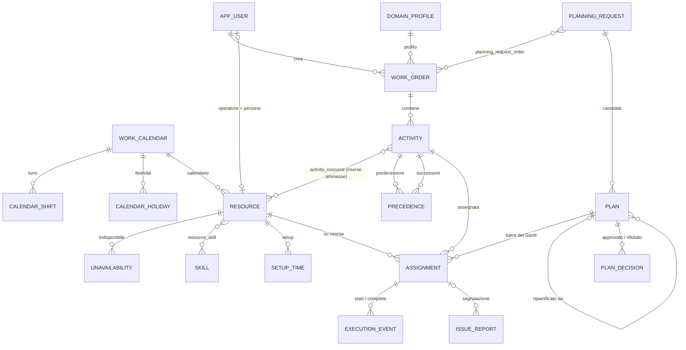

# FlowSync – Database

Schema MySQL 8 del backend Spring Boot, versionato con Flyway. 23 tabelle e 1 vista, divise per modulo del monolite modulare.

## Diagramma ER (parte principale)



## Tabelle per modulo

| Modulo | Tabelle | A cosa servono |
|---|---|---|
| Security | `app_user` | Utenti con ruolo ADMIN, PLANNER, OPERATOR; l'operatore è collegato alla sua risorsa "persona" |
| Configuration | `domain_profile`, `work_calendar`, `calendar_shift`, `calendar_holiday`, `skill`, `resource`, `resource_skill`, `unavailability` | Profili di dominio con pesi predefiniti, turni, festività, risorse, competenze, manutenzioni e ferie |
| Orders | `work_order`, `activity`, `activity_resource`, `precedence`, `setup_time` | Commesse, attività (nodi), risorse ammesse, precedenze (archi), matrice dei setup |
| Planning | `planning_request`, `planning_request_order`, `plan`, `assignment` | Richiesta all'AI con snapshot della ProblemSpec, piani candidati con KPI, barre del Gantt con la stima di M1 |
| Decisions | `plan_decision` | Approvazioni e rifiuti con motivazione |
| Execution | `execution_event`, `issue_report`, vista `v_activity_actuals` | Inizio e fine registrati dall'operatore, guasti; la vista dà le durate reali per addestrare M1 |
| Audit | `audit_log` | Chi ha fatto cosa, con prima/dopo in JSON |
| Models | `model_version` | Versioni pubblicate dalla pipeline di training (contratto C); al massimo una ACTIVE per modello |

## Scelte di progetto

- **Flyway crea lo schema, Hibernate lo controlla** (`ddl-auto: validate`). Una migrazione già applicata non si modifica mai: per cambiare qualcosa si aggiunge `V7__...sql`.
- **Gli "enum" sono `VARCHAR` + `CHECK`**, non `ENUM` di MySQL. Aggiungere un valore costa una migrazione di una riga, e su Java `@Enumerated(STRING)` resta leggibile.
- **Date e ore in `DATETIME(6)`, sempre in UTC.** In Java si usa `Instant`; il fuso (Europe/Rome) lo applica il frontend. Fanno eccezione i turni (`TIME`), che sono orari locali del calendario.
- **JSON dove la struttura varia**: ProblemSpec, pesi degli obiettivi, dettagli dei KPI, payload dell'audit. I KPI che servono per ordinare e filtrare (makespan, ritardo, straordinari, utilizzo) sono invece colonne normali.
- **`planning_request.problem_spec` è uno snapshot.** Il piano resta riproducibile anche se commesse o risorse cambiano dopo, e ogni richiesta reale diventa un esempio in più per il training.
- **I cicli nel grafo li controlla il servizio**, non il DB. MySQL non permette un `CHECK predecessor_id <> successor_id` sulle colonne con `ON DELETE CASCADE`.
- **Lock ottimistico (`@Version`)** su `work_order` e `plan`: due pianificatori che modificano lo stesso piano non si sovrascrivono a vicenda.
- **`execution_event` è append-only.** Non si corregge un evento, se ne aggiunge un altro. La vista `v_activity_actuals` confronta durata reale e stima di M1: è il dataset di M1 in produzione.

## Migrazioni

| File | Contenuto |
|---|---|
| `V1__security.sql` | `app_user` |
| `V2__configuration.sql` | Profili, calendari, risorse, competenze, indisponibilità; collegamento utente → risorsa |
| `V3__orders.sql` | Commesse, attività, risorse ammesse, precedenze, setup |
| `V4__planning.sql` | Richieste, piani, assegnazioni |
| `V5__decisions_execution.sql` | Decisioni, eventi di esecuzione, segnalazioni, vista per M1 |
| `V6__audit_models.sql` | Audit e versioni dei modelli |
| `db/seed/V100__demo_data.sql` | Solo profilo `dev`: l'officina dei mockup (utenti demo, 9 risorse, C-101…C-104, manutenzione CNC 2) |
| `db/seed/V102__frontend_demo_users.sql` | Solo profilo `dev`: utenti demo rinominati come nel frontend, password `demo` |

Gli utenti demo (`amministratore`, `pianificatore`, `operatore`, allineati al frontend) hanno password `demo`, da usare solo in sviluppo. I nomi e la password sono impostati da `db/seed/V102__frontend_demo_users.sql`.

## Entità JPA incluse

Package `it.unicam.flowsync.<modulo>.domain`: `AppUser`, `Resource`, `WorkCalendar` (con `Shift`), `Unavailability`, `WorkOrder`, `Activity`, `Precedence`, `PlanningRequest`, `Plan`, `Assignment`, `ExecutionEvent`, `AuditLog`.
Le tabelle restanti (`skill`, `domain_profile`, `setup_time`, `plan_decision`, `issue_report`, `model_version`, …) seguono lo stesso schema.

Dipendenze: `spring-boot-starter-data-jpa`, `flyway-core` + `flyway-mysql`, `mysql-connector-j`, `lombok`.

## Da verificare al primo avvio

Il codice Java non è stato compilato: in questo ambiente Maven Central non è raggiungibile. Il primo test è avviare il backend con `ddl-auto: validate` su un MySQL 8 vuoto. Due punti da controllare:

- **Booleani:** sono mappati con `columnDefinition = "TINYINT(1)"`, perché su MySQL `BOOLEAN` diventa `TINYINT(1)` e Hibernate 6 altrimenti si aspetta `BIT`.
- **Enum:** sono mappati con `@JdbcTypeCode(SqlTypes.VARCHAR)`, perché da Hibernate 6.2 su MySQL l'enum diventerebbe un `ENUM` nativo.

Se la validazione segnala una colonna, quasi sempre si tratta di una differenza di tipo come queste.

---

# Backend REST

Implementato: fondamenta (errori, sicurezza), login JWT, registrazione con approvazione, modulo Configuration (risorse; competenze, calendari e profili di dominio in sola lettura) e commesse con grafo di processo. Il resto del contratto A (`CONTRATTI_API.md`) segue modulo per modulo.

## Avvio in locale

```bash
mvn spring-boot:run -Pdev      # avvia anche il MySQL di compose.yaml, applica Flyway e carica i dati demo
```

Con il profilo `dev` Spring Boot esegue da solo `docker compose up` su `compose.yaml`, aspetta che MySQL sia *healthy* e si collega al container (URL, utente e password li legge dal container, non dal datasource). Serve Docker Desktop acceso. Quando fermi l'app il container resta acceso (`lifecycle-management: start-only`); per spegnerlo `docker compose down`, per ripartire da un DB vuoto `docker compose down -v`. Il seed dei dati demo è la migrazione `V100`: per questo il profilo `dev` ha `spring.flyway.out-of-order: true`, altrimenti ogni nuova migrazione (V7, V8, …) verrebbe rifiutata su un DB di sviluppo che ha già il seed. Le migrazioni nuove si numerano comunque in sequenza (V8, V9, …), mai sopra 100. Dall'IDE: run configuration con profilo attivo `dev` e working directory `src/backend`. Senza `dev` il supporto Docker è spento, e nei test resta spento comunque (usano Testcontainers, un MySQL separato e usa e getta).

Password del DB e segreto JWT stanno in `src/backend/.env` (escluso da git; il modello è `.env.example`: `cp .env.example .env`). Lo leggono sia Spring Boot (`spring.config.import` in `application.yml`) sia `docker compose`; una variabile d'ambiente con lo stesso nome vince sul file. Nel `.env` niente virgolette: Spring lo legge come file `.properties`, quindi le virgolette diventerebbero parte del valore. Il file si cerca nella cartella da cui parte l'app: avviare da `src/backend` (anche nella run configuration dell'IDE). Senza `.env`, il profilo `dev` ha comunque valori di comodo; fuori da `dev` servono `DB_PASSWORD` e `JWT_SECRET` (almeno 32 caratteri). Utenti demo: `amministratore` (ADMIN), `pianificatore` (PLANNER), `operatore` (OPERATOR), tutti con password `demo` (gli stessi del frontend).

- Swagger UI: <http://localhost:8080/swagger-ui.html> (bottone *Authorize*: incollare l'`accessToken` del login)
- Salute: <http://localhost:8080/actuator/health>

```bash
curl -s localhost:8080/api/v1/auth/login -H 'Content-Type: application/json' \
     -d '{"username":"amministratore","password":"demo"}'
curl -s localhost:8080/api/v1/resources -H "Authorization: Bearer <accessToken>"
```

Con il frontend: in `src/frontend/.env.development` mettere `VITE_USE_MOCKS=false` e fare il proxy di `/api` verso `localhost:8080` nella configurazione di Vite. Il frontend ha già la pagina di login e manda `Authorization: Bearer <accessToken>` a ogni chiamata; il proxy verso `localhost:8080` è già in `vite.config.ts`.

## Test

```bash
mvn test        # richiede Docker acceso: Testcontainers avvia un MySQL 8.4 vero, unico per tutta la suite
```

| Classe | Cosa verifica |
|---|---|
| `SchemaAndMigrationsTest` | Il contesto parte: Flyway applica V1–V6 + seed e Hibernate (`ddl-auto: validate`) trova le entità coerenti con lo schema. **È il primo test da guardare.** |
| `AuthApiTest` | Login, refresh, `/auth/me`, token manomesso o del tipo sbagliato, formato problem+json |
| `RegistrationApiTest` | Registrazione, account in attesa, approvazione con ruolo, rifiuto, disattivazione, protezione dall'auto-blocco dell'ADMIN |
| `ResourceApiTest` | Permessi per ruolo, CRUD, disattivazione, 404/409/422, competenze, riepilogo dei turni |
| `OrderApiTest` | Profili di dominio, commesse del seed, filtri, creazione, modifica, annullamento, grafo (salvataggio, sostituzione, cicli, riferimenti) |
| `GraphValidatorTest` | Logica pura del controllo del grafo (senza Docker) |
| `ShiftSummarizerTest` | Logica pura del riepilogo turni (senza Docker) |

## Endpoint implementati

| Metodo | Path | Ruoli | Note |
|---|---|---|---|
| POST | `/api/v1/auth/login` | pubblico | access (15 min) + refresh (7 giorni) |
| POST | `/api/v1/auth/refresh` | pubblico | accetta solo refresh token |
| POST | `/api/v1/auth/register` | pubblico | 201, account **in attesa** (nessun token); il ruolo lo sceglie l'ADMIN |
| GET | `/api/v1/auth/me` | tutti | |
| GET | `/api/v1/resources[?active=]` | tutti | |
| GET | `/api/v1/resources/{id}` | tutti | `id` = codice (es. `LASER`) |
| POST / PUT | `/api/v1/resources[/{id}]` | ADMIN | 409 codice doppio, 422 competenza o calendario inesistenti |
| DELETE | `/api/v1/resources/{id}` | ADMIN | disattiva (204), idempotente |
| GET | `/api/v1/skills`, `/api/v1/calendars` | tutti | alimentano le tendine del frontend |
| GET | `/api/v1/domain-profiles[/{code}]` | tutti | pesi con le chiavi del contratto (`makespan`, `weightedTardiness`, `setup`) |
| GET / POST | `/api/v1/orders[?status=&dueBefore=]` | PLANNER, ADMIN | `id` = codice (es. `C-101`); `activityCount` nell'elenco |
| GET / PUT | `/api/v1/orders/{id}` | PLANNER, ADMIN | 409 se la commessa è chiusa (DONE / CANCELLED) |
| DELETE | `/api/v1/orders/{id}` | PLANNER, ADMIN | annulla (stato `CANCELLED`), idempotente |
| PATCH | `/api/v1/orders/{id}/priority` | PLANNER, ADMIN | corpo `{"priority": 1..3}` |
| GET / PUT | `/api/v1/orders/{id}/process-graph` | PLANNER, ADMIN | PUT sostituisce il grafo; 422 per cicli, riferimenti sbagliati, modi non validi |
| GET | `/api/v1/users[?status=PENDING\|ACTIVE\|DISABLED]` | ADMIN | `?status=PENDING` = registrazioni da approvare |
| POST | `/api/v1/users/{id}/approve` | ADMIN | corpo `{"role": "PLANNER"}`; 409 se non è in attesa |
| PATCH | `/api/v1/users/{id}` | ADMIN | `{"role": ..., "active": ...}`; un ADMIN non può disattivare sé stesso né togliersi il ruolo |
| DELETE | `/api/v1/users/{id}` | ADMIN | rifiuta (cancella) una registrazione in attesa; gli utenti approvati si disattivano |

## Scelte

- **L'`id` pubblico è il codice**, non la chiave BIGINT: `LASER`, `ORD-0012`. Il frontend non vede mai gli id numerici. Per i calendari, che non hanno un codice nello schema, l'`id` è la chiave numerica come stringa opaca (`"1"`).
- **Errori sempre `application/problem+json`**, anche quelli dei filtri di sicurezza (401/403), con `traceId` (uguale all'header `X-Request-Id`, lo si ritrova nei log). Un input sintatticamente valido ma inconsistente è 422 con l'elenco `errors[{code, path, message}]`; il JSON malformato è 400.
- **JWT HS256 con il resource server di Spring Security**, nessuna libreria in più. Access e refresh hanno un claim `token_use`: un refresh token non apre le API e un access token non rinnova. Il refresh rilegge l'utente dal DB, quindi un account disattivato o un ruolo cambiato valgono subito al rinnovo.
- **Limite noto:** i refresh token non si possono revocare prima della scadenza (niente tabella dei token). Per un prototipo è accettabile; se serve il logout "vero" si aggiunge una tabella con i `jti` revocati.
- **Nessun limite ai tentativi di login** per ora (da aggiungere prima di un uso reale).
- **Registrazione con approvazione.** `POST /auth/register` crea un account disattivato (stato `PENDING`, migrazione V7: colonne `approved_at` e `approved_by`). Il login di un account in attesa o disattivato risponde 403 con codice `ACCOUNT_PENDING` / `ACCOUNT_DISABLED`, ma solo se la password è giusta: con la password sbagliata il messaggio resta il generico 401, così non si scopre lo stato degli account altrui. Un campo `role` inviato alla registrazione è ignorato. Limiti: la registrazione rivela se uno username o un'email sono già usati (409), e non c'è un limite alle richieste: un bot può riempire la lista delle attese (gli account restano inutilizzabili finché nessuno li approva).
- **Commesse: conversioni tra contratto e DB.** `description` (proposta §8 del frontend) = `title`; `customer` = `client_name`; `priority` 1/2/3 = `LOW`/`MEDIUM`/`HIGH`; lo stato `OPEN` del contratto = `DRAFT` o `READY` (le nuove nascono `READY`). Senza `releaseDate` si restituisce la data di creazione.
- **Grafo di processo.** Il PUT sostituisce tutto il grafo ma lavora per codice: le attività che restano conservano id e famiglia di setup (`setupFamily`, campo facoltativo in più rispetto al contratto), quelle sparite si cancellano (409 se un piano le usa). Un modo = una risorsa (la colonna `duration_min` di `activity_resource`); se tutti i modi hanno la stessa durata, quella diventa `declared_duration_min`. Solo precedenze `FS`. I controlli strutturali (id doppi, modi, cicli) stanno nella classe pura `GraphValidator`, testata senza Docker.
- **Migrazione V8** (tutti gli ambienti): `work_order.release_at`, tabella `activity_skill` (le competenze richieste diventano una lista; i dati di `required_skill_id` sono copiati e la colonna tolta), `precedence.max_lag_min`, `domain_profile.description` e `features`. **Seed V101** (solo dev): profili FACTORY e PA nel formato del contratto e profilo PROJECT. In produzione i profili vanno ancora creati: manca la scrittura (`PUT /domain-profiles`).
- **Le competenze di una risorsa** si inviano come elenco di codici; le nuove partono dal livello 1, quelle già presenti conservano il loro livello.

## Difformità da chiarire con il frontend

- `ResourceType` nel frontend è `MACHINE | PERSON | ROOM`, ma lo schema ammette anche `TEAM` e il backend lo restituisce.
- Il frontend si aspetta `costPerHour` e `unavailability` nella risorsa (PROPOSTA §8 di `FRONTEND_STRUTTURA.md`): il backend per ora li ignora in scrittura e non li restituisce. Servono una colonna in più (migrazione V7) e una decisione sul contratto.
- `CONTRATTI_API.md` e `Spiegazione_architettura_VPP.txt` nominano ancora Angular.
