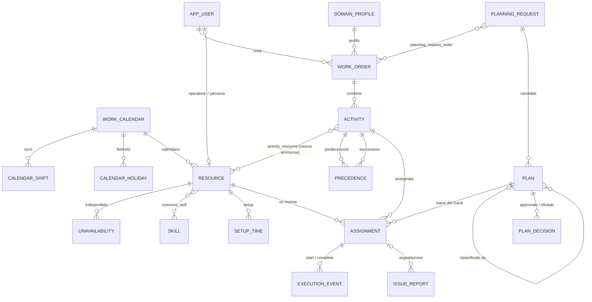

# FlowSync – Database

Schema MySQL 8 del backend Spring Boot, versionato con Flyway. 23 tabelle e 1 vista, divise per modulo del monolite modulare.

## Diagramma ER (parte principale)

## Tabelle per modulo

| Modulo | Tabelle | A cosa servono |
|---|---|---|
| Security | `app_user` | Utenti con ruolo ADMIN, PLANNER, OPERATOR; l'operatore è collegato alla sua risorsa "persona" |
| Configuration | `domain_profile`, `work_calendar`, `calendar_shift`, `calendar_holiday`, `skill`, `resource`, `resource_skill`, `unavailability` | Profili di dominio con pesi predefiniti, turni, festività, risorse, competenze, manutenzioni e ferie |
| Orders | `work_order`, `activity`, `activity_resource`, `precedence`, `setup_time` | Commesse, attività (nodi), risorse ammesse, precedenze (archi), matrice dei setup |
| Planning | `planning_request`, `planning_request_order`, `plan`, `assignment` | Richiesta all'AI con snapshot della ProblemSpec, piani candidati con KPI, barre del Gantt con la stima di M1 |
| Decisions | `plan_decision` | Approvazioni e rifiuti con motivazione |
| Execution | `execution_event`, `issue_report`, vista `v_activity_actuals` | Inizio e fine registrati dall'operatore, guasti; la vista dà le durate reali per addestrare M1 |
| Audit | `audit_log` | Chi ha fatto cosa, con prima/dopo in JSON |
| Models | `model_version` | Versioni pubblicate dalla pipeline di training (contratto C); al massimo una ACTIVE per modello |

## Scelte di progetto

- **Flyway crea lo schema, Hibernate lo controlla** (`ddl-auto: validate`). Una migrazione già applicata non si modifica mai: per cambiare qualcosa si aggiunge `V7__...sql`.
- **Gli "enum" sono `VARCHAR` + `CHECK`**, non `ENUM` di MySQL. Aggiungere un valore costa una migrazione di una riga, e su Java `@Enumerated(STRING)` resta leggibile.
- **Date e ore in `DATETIME(6)`, sempre in UTC.** In Java si usa `Instant`; il fuso (Europe/Rome) lo applica il frontend. Fanno eccezione i turni (`TIME`), che sono orari locali del calendario.
- **JSON dove la struttura varia**: ProblemSpec, pesi degli obiettivi, dettagli dei KPI, payload dell'audit. I KPI che servono per ordinare e filtrare (makespan, ritardo, straordinari, utilizzo) sono invece colonne normali.
- **`planning_request.problem_spec` è uno snapshot.** Il piano resta riproducibile anche se commesse o risorse cambiano dopo, e ogni richiesta reale diventa un esempio in più per il training.
- **I cicli nel grafo li controlla il servizio**, non il DB. MySQL non permette un `CHECK predecessor_id <> successor_id` sulle colonne con `ON DELETE CASCADE`.
- **Lock ottimistico (`@Version`)** su `work_order` e `plan`: due pianificatori che modificano lo stesso piano non si sovrascrivono a vicenda.
- **`execution_event` è append-only.** Non si corregge un evento, se ne aggiunge un altro. La vista `v_activity_actuals` confronta durata reale e stima di M1: è il dataset di M1 in produzione.

## Migrazioni

| File | Contenuto |
|---|---|
| `V1__security.sql` | `app_user` |
| `V2__configuration.sql` | Profili, calendari, risorse, competenze, indisponibilità; collegamento utente → risorsa |
| `V3__orders.sql` | Commesse, attività, risorse ammesse, precedenze, setup |
| `V4__planning.sql` | Richieste, piani, assegnazioni |
| `V5__decisions_execution.sql` | Decisioni, eventi di esecuzione, segnalazioni, vista per M1 |
| `V6__audit_models.sql` | Audit e versioni dei modelli |
| `db/seed/V100__demo_data.sql` | Solo profilo `dev`: l'officina dei mockup (utenti demo, 9 risorse, C-101…C-104, manutenzione CNC 2) |

Gli utenti demo (`admin`, `gneri`, `mrossi`) hanno password `flowsync-dev`, da usare solo in sviluppo.

## Entità JPA incluse

Package `it.unicam.flowsync.<modulo>.domain`: `AppUser`, `Resource`, `WorkCalendar` (con `Shift`), `Unavailability`, `WorkOrder`, `Activity`, `Precedence`, `PlanningRequest`, `Plan`, `Assignment`, `ExecutionEvent`, `AuditLog`.
Le tabelle restanti (`skill`, `domain_profile`, `setup_time`, `plan_decision`, `issue_report`, `model_version`, …) seguono lo stesso schema.

Dipendenze: `spring-boot-starter-data-jpa`, `flyway-core` + `flyway-mysql`, `mysql-connector-j`, `lombok`.

## Da verificare al primo avvio

Il codice Java non è stato compilato: in questo ambiente Maven Central non è raggiungibile. Il primo test è avviare il backend con `ddl-auto: validate` su un MySQL 8 vuoto. Due punti da controllare:

- **Booleani:** sono mappati con `columnDefinition = "TINYINT(1)"`, perché su MySQL `BOOLEAN` diventa `TINYINT(1)` e Hibernate 6 altrimenti si aspetta `BIT`.
- **Enum:** sono mappati con `@JdbcTypeCode(SqlTypes.VARCHAR)`, perché da Hibernate 6.2 su MySQL l'enum diventerebbe un `ENUM` nativo.

Se la validazione segnala una colonna, quasi sempre si tratta di una differenza di tipo come queste.
